<!-- Generated by GitHub Profile Agent Console. Edit profile.config.json, then run npm run generate. -->

  <picture>
    <source media="(max-width: 760px) and (prefers-color-scheme: dark)" srcset="./assets/hero/agent-console-e0c79d15-mobile-dark.svg">
    <source media="(max-width: 760px)" srcset="./assets/hero/agent-console-e0c79d15-mobile-light.svg">
    <source media="(prefers-color-scheme: dark)" srcset="./assets/hero/agent-console-e0c79d15-dark.svg">
    <source media="(prefers-color-scheme: light)" srcset="./assets/hero/agent-console-e0c79d15-light.svg">
    
  </picture>

  

## About Me

Full Stack Developer with experience building scalable web applications, ERP systems, HRIS platforms, POS solutions, and AI-powered automation.

Passionate about creating clean, high-performance software with modern technologies while delivering practical solutions for businesses.

## Current Focus

| Area | What I am exploring |
| --- | --- |
| **Enterprise Application** | Building ERP, HRIS, POS, and business management platforms |

## Featured Work

| Project | Focus | Why it matters |
| --- | --- | --- |
| [**Luthen HRIS**](https://github.com/ulmauull) | Human Resource Information System | A modern HRIS platform featuring attendance tracking, payroll management, GPS verification, face recognition, and employee management. [Live](https://luthen.nobelux.co.id) |
| [**Selin POS**](https://github.com/ulmauull) | Pos App | Providing custom software development, AI automation, web applications, mobile applications, ERP systems, and UI/UX solutions. [Live](https://selin.nobelux.co.id) |

## Research Direction

I enjoy designing and developing scalable applications, integrating AI into business workflows, and building systems that improve productivity and user experience.

## Tech Stack

`PHP` · `Javascript` · `React` · `Node.js` · `MySQL` · `Supabase` · `Bootstrap` · `Tailwind CSS` · `Git` · `Cloudflare R2` · `REST API`

## Recent Activity

<!-- AUTO:ACTIVITY:START -->
- Aug 3, 2026: pushed 1 commit to [ulmauull/coffee-brand-website](https://github.com/ulmauull/coffee-brand-website).
- Aug 3, 2026: pushed 1 commit to [ulmauull/ulmauull](https://github.com/ulmauull/ulmauull).
- Aug 3, 2026: created a branch in [ulmauull/ulmauull](https://github.com/ulmauull/ulmauull).
<!-- AUTO:ACTIVITY:END -->

---

  Building modern software that empowers businesses through technology.

